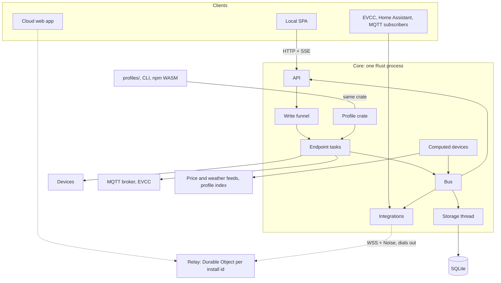

# Architecture

Dashed links: designed for, not in the first release (ADR 1). Principles: ADR 19.

| Module | Interface | ADR |
| --- | --- | --- |
| Profile crate | Load a profile into a read plan, decode, lint, report capabilities; identical natively and in WASM | 5 |
| Endpoint task | One per endpoint; runs read plans and recipes serially, publishes readings with their age | 6 |
| Bus | Typed readings (device, series, value, time); subscribe | 6 |
| Computed devices | Publish readings like hardware; each fetch in its own task | 12, 14, 15, 17 |
| Weather source | Adapter per provider: plain irradiance, temperature and wind for a location | 17 |
| PV model (`pv` crate) | Pure `estimate(layout, weather)` → series per string, MPPT input and inverter, per-module shading; also builds for WASM | 17, 20 |
| Write funnel | `write(device, setting, value, actor)` → outcome | 7 |
| Storage thread | Sole SQLite owner, fed by a channel: change points, blocks, rollups, forecasts, write log | 3, 15 |
| API | REST `/api/v1`, SSE live, OpenAPI, auth | 9 |
| Integrations | Role endpoint, MQTT publisher, relay | 10, 16 |
| SPA | Renders from capabilities; one transport interface | 11 |
| 3D scene | Pure functions build the scene from the layout; one thin three.js component draws it | 20 |
| Profile tooling | TypeScript authoring API and CLI over the WASM; `sunreye capture` records | 5, 6, 8 |
