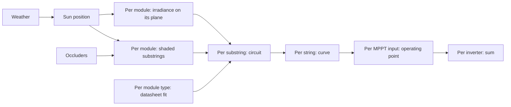

# PV model

How `sunreye_pv::estimate(layout, weather)` turns one weather instant into watts per string, MPPT input and inverter. Decisions: ADR 17 (model), ADR 20 (scene and shade). Code: `crates/pv/src`.

The model is pure: no I/O, no clock, no state between calls. One call is one instant.

## Inputs

| Input | Holds | From |
| --- | --- | --- |
| `Layout.location` | Latitude, longitude | The plant's location |
| `Layout.inverters[].inputs[]` | An MPPT input: its MPPT window (`limits`, optional) and its strings in parallel | The PV layout and the inverter profile (ADR 5) |
| `PvString` | A module type, a loss in %, and its modules in series | The PV layout |
| `Module` | A plane (tilt, azimuth), whether it has an optimizer, and a place (centre, orientation) when a scene places it | `Scene::modules`, else the string's form values |
| `ModuleType` | Vmp, Imp, Voc, Isc, voltage and current coefficients, width, height, bypass diodes | The module type |
| `Layout.occluders` | Triangles, spheres, upright cylinders, upright cones, in the frame of the modules' places | `Scene::occluders` |
| `Weather` | Unix time, GHI, DNI, DHI in W/m², air temperature, wind if known | A weather forecast, archive weather, or `clear_weather` |

Azimuths: 0 = south, −90 = east, 90 = west. Points: metres east, north, up.

A string entered by form has one plane and no places, so nothing shades it. A scene gives each module its roof face's plane and its place, whatever the form says.

**Scene to occluders.** Every face of a block, roof, chimney, box and hedge becomes a fan of triangles. A broadleaf is a trunk cylinder under a sphere, a conifer a trunk under a cone, a pole and a carport post a cylinder. Ground surfaces, fences, openings and roof windows cast nothing.

## Stages



1. **Sun position** (`sun.rs`). Meeus's low-precision coordinates give zenith and azimuth from the time and the location: geometric, unrefracted. Everything below needs the sun's direction.
2. **Transposition: irradiance on the plane** (`perez.rs`), per module. Perez 1990 splits GHI, DNI and DHI into beam, sky diffuse and ground diffuse (albedo 0.25) on the module's plane. Weather sources deliver plain irradiance, so any source fits (ADR 17).
3. **Incidence loss** (`string.rs`). Martin and Ruiz on the beam; a constant 0.95 on diffuse. Glass reflects more at flat angles.
4. **Cell temperature** (`temperature.rs`). Faiman with wind, the NOCT rise without, from the unshaded irradiance on the plane. Heat lowers voltage.
5. **Shade** (`shade.rs`), per placed module with beam on its front. See below.
6. **Datasheet fit** (`diode.rs`), per string. De Soto's five parameters at standard test conditions, by Newton's method on the datasheet, as pvlib's `fit_desoto`. A datasheet that fits no circuit yields a string of 0 W.
7. **Substring circuit** (`diode.rs`). The fitted circuit moved to the substring's effective irradiance and the cell temperature, split into equal substrings, as pvlib's `calcparams_desoto`. A lit substring sees beam and diffuse, a shaded one diffuse only, one without light none.
8. **String curve** (`string.rs`). Equal substrings are grouped. The string's voltage at a current is the sum of its substrings' voltages, each from its single-diode equation by Newton's method and held at −0.5 V once its bypass diode conducts. The curve keeps this voltage at 129 evenly spaced currents from zero to its highest photocurrent. The string's loss scales its current.
9. **Optimizers** (`string.rs`). An optimized module is taken out of the series: its own peak, found on its own curve, less 1 %, is delivered at any string current, so it adds power ÷ current volts.
10. **Operating point** (`mppt.rs`), per MPPT input. Parallel strings share one voltage and their currents add. A string's current at a voltage inverts its curve: the Illinois method between the two samples around that voltage. The input's power is tried at every string's sample voltages and at the window's ends; each local peak is refined by golden section, and the highest wins. Shade makes several peaks, which is why the whole curve is scanned.
11. **MPPT window** (`mppt.rs`). Without limits nothing is capped. With them: an open-circuit voltage under the window's bottom or the start voltage yields nothing; the search stays inside the window; the current is capped at the input's maximum.
12. **Shares and sum** (`mppt.rs`, `estimate.rs`). An input's power is split among its strings by their modelled current at the operating point. An inverter is the sum of its inputs. The AC rating is not applied here: the solar forecast caps, so the learner sees what a clipped hour would have produced (ADR 17).

## A year's run

`sunreye_pv::year(layout, weather, step)` runs `estimate` at each weather sample and holds its watts for `step` seconds: energy in Wh for every string, MPPT input and inverter, by UTC month and over the run. Months are UTC because the crate knows no time zone; at a quarter-hour step the plant-local boundary moves only night hours. A sample with no irradiance is skipped. Strings sum to their input and inputs to their inverter, as each instant's estimate does.

`@sunreye/pv-wasm`'s `year` takes the plant as `clearSky` does, each inverter's inverter type for its MPPT limits, and the weather as columns at a fixed step from a start instant. It returns each string's energy by position and each inverter's by device id with its inputs by number.

## How shade reaches the electrics

- A module has one substring per bypass diode: strips along its long side, side by side across its short side.
- Each substring has 27 sample points, 3 across its strip and 9 along it. From each a ray runs toward the sun.
- A ray that meets an occluder further than 1 µm away is blocked. The clearance keeps a module's own roof from shading it.
- A substring with any blocked sample loses its whole beam: its most shaded cell limits its current. It keeps its diffuse light.
- The shaded substring's circuit has a lower photocurrent. In series with lit substrings it either drags the string's current down or is bypassed at −0.5 V. Both show on the string's curve as a step, and on the input's power as a second peak. The operating point takes whichever peak is higher inside the MPPT window.
- An optimized module keeps its shade to itself: only its own peak drops.

Per sun, `Casters` prepares each occluder once: a triangle's ray-dependent terms, and a bounding ball. Per module, it keeps only casters that could shade it: not behind it along the ray, not beside its rays, not on or behind its own plane. The bounds are conservative, so every sample meets the same casters as an exhaustive test.

## Validation

`crates/pv/fixtures/generate.py` writes golden values from pvlib 0.16.1. Each stage has its own fixture, so a failure names the stage.

| Fixture | Checks | Tolerance |
| --- | --- | --- |
| `sun.csv` | Sun position against NREL SPA | 0.02° |
| `perez.csv` | Beam, sky diffuse, ground diffuse on eight planes, every clearness bin | 1e-9 |
| `clearsky.csv` | `clear_sky` against Ineichen and Perez | 1e-9 |
| `desoto.csv` | The datasheet fit against `fit_desoto` | 1e-7 |
| `string.csv` | One string's power, voltage, current at its peak | 1e-6 |
| `input.csv` | Shade, optimizers, parallel strings and MPPT limits on one input | 1e-6 |
| `estimate.csv` | The whole chain for the owner's wiring through a day | 0.1 % or 0.5 W |

pvlib knows no scene. Geometry is checked by hand-worked cases (`tests/shade.rs`, `roofing.rs`, `surroundings.rs`, `grid.rs`), and `tests/profile.rs` pins a whole scene's shaded substrings and input powers at nine instants, three more with optimizers and a binding current limit, and checks the bounds that rule casters out against testing every caster.

## Callers

`solar::estimates` in the core runs the model for each weather target under the layout version in force, on tokio's blocking pool (ADR 2). It serves the solar forecast (about 200 targets after each weather fetch), the corrections and their report, and the clear-sky index. The browser runs the same crate as WASM for the builder's clear-sky day (ADR 20).

## Cost

Measured by `tests/profile.rs` on a plant like the owner's: 46 modules in three strings on two MPPT inputs, a saved scene with 39 occluders, a clear day at 15 minute instants, release profile (`opt-level = "s"`, fat LTO). Run it with:

```sh
cargo test -p sunreye-pv --release cost_by_stage -- --ignored --nocapture
```

Add `--target x86_64-unknown-linux-musl` for the amd64 image's libc. Milliseconds per instant on the June day, 66 of 96 instants lit, by the names the profile prints; a dark instant costs nothing.

| Stage | Stages above | glibc | musl |
| --- | --- | --- | --- |
| sun position | 1 | 0.0003 | 0.0006 |
| transposition | 2 | 0.004 | 0.008 |
| shade | 5 | 0.05 | 0.19 |
| datasheet fit | 6 | 0.010 | 0.025 |
| rest of the curves | 3, 4, 7, 8, 9 | 0.05 | 0.06 |
| operating point | 10, 11, 12 | 0.35 | 0.40 |
| estimate | all | 0.46 | 0.68 |

What the cost is made of:

- **The operating point is diode solves.** Each power tried at a voltage inverts every string's curve, each inversion solves every group's diode a few times, and each solve is a few Newton steps with one exponential.
- **Allocation is negligible:** under 100 per instant, on either libc.
- **`mul_add` is a libm call where the target's baseline has no FMA:** x86-64 and WASM. glibc dispatches to the instruction at run time; musl computes it in software. arm64 has FMA in its baseline. A diode's voltage, the innermost loop, therefore uses plain arithmetic. The vector helpers shade uses still call `mul_add`, which is musl's remaining gap.
- **Shade is cheap only because of the bounds** above: without them it is 46 modules × 81 samples × 39 occluders.

Not done, each needing a decision:

- **FMA in the amd64 image.** Closes the rest of the musl gap. The image would then die on a CPU without FMA: anything before Haswell, and the Atom-class Celerons. ADR 2.
- **Plain arithmetic in the vector helpers.** `dot`, `cross` and `offset` also place the scene's geometry, where a changed last digit can reach tests that compare coordinates exactly.
- **A coarser peak.** Golden section refines voltage to 1e-13, about 60 steps per peak and a third of the operating point, though the flat peak fixes voltage only to about 1e-8. So do the 128 samples per curve. Both trade accuracy against pvlib.
- **One model per layout version in the core.** `solar::estimates` rebuilds the layout from the scene per target: 7 µs of 296 µs on the tests' walled house.
